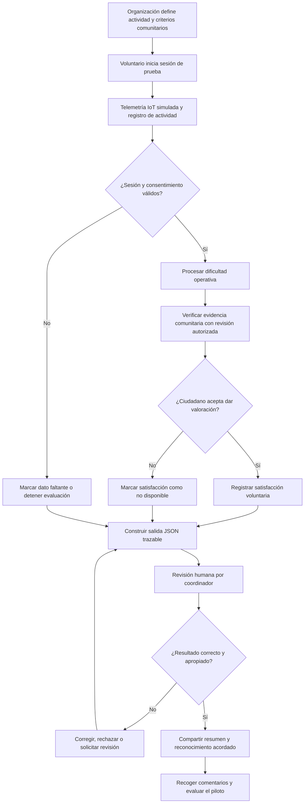

# Sistema de Gestión Jukurrpa: Plenitude & Moola


## 1. El problema

La automatización puede desplazar tareas y reducir oportunidades de empleo, mientras que las personas afectadas siguen necesitando ingresos, pertenencia, propósito y reconocimiento social. En paralelo, las organizaciones comunitarias requieren apoyo voluntario confiable, pero a menudo carecen de una manera consistente y respetuosa de registrar las actividades, reconocer el esfuerzo y saber si el servicio fue útil para las personas atendidas.

El proyecto explora si una herramienta de gestión puede conectar oportunidades de voluntariado con personas que buscan participar y ser reconocidas por una contribución significativa. El reconocimiento de estatus se plantea como una consecuencia de la participación voluntaria y del valor percibido por la comunidad, no como sustituto del empleo, del ingreso digno ni de servicios sociales.

**Problema que se quiere comprobar:** voluntarios y organizaciones no cuentan con un proceso sencillo, verificable y culturalmente gobernado para registrar la actividad, reflejar el esfuerzo realizado y recoger la valoración de quienes recibieron el servicio.

**Personas involucradas:**

- Personas voluntarias, incluidas personas afectadas por cambios en el empleo.
- Organizaciones que coordinan actividades voluntarias.
- Ciudadanos que reciben el servicio.
- Representantes comunitarios con autoridad para definir el uso apropiado de información cultural.

## 2. Definición de éxito exacto del usuario

### Resultado buscado

Al terminar una actividad voluntaria, una persona coordinadora puede registrar la sesión y obtener un resumen estructurado, trazable y comprensible que ayude a reconocer el esfuerzo, mejorar la asignación de futuras actividades y confirmar —cuando la persona atendida lo acepte— si el servicio fue satisfactorio.

### Entrada

Una sesión de voluntariado con **telemetría IoT simulada**, generada localmente para el prototipo. La entrada puede incluir:

- Identificador seudónimo de la sesión y del voluntario.
- Tipo de actividad y duración.
- Eventos simulados de inicio, pausa y finalización.
- Indicadores no invasivos de ejecución de la tarea, como pasos completados o herramientas utilizadas.
- Categoría de dificultad declarada por el coordinador y observaciones operativas.
- Valoración opcional del ciudadano servido, recogida con consentimiento.
- Evidencia de contribución comunitaria definida previamente por la organización y validada por representantes autorizados.

La simulación no recopila datos reales de ubicación, audio, vídeo, biometría ni contenido cultural sagrado. La participación y la encuesta de satisfacción son voluntarias; la negativa a responder no reduce el reconocimiento de la persona voluntaria.

### Procesamiento

El prototipo aplica una regla de evaluación asistida por IA/ML para resumir tres dimensiones:

1. **Dificultad de la actividad:** estima el nivel operativo a partir de la categoría acordada, la duración, los pasos completados y las incidencias reportadas. La estimación se presenta como orientativa y revisable.
2. **Contribución comunitaria/cultural:** comprueba si hay evidencia de una contribución que la propia comunidad haya definido como pertinente para esa actividad. El sistema no determina qué es auténtico, valioso o culturalmente correcto, no interpreta conocimiento cultural sensible y no asigna una puntuación automática al valor cultural. La validación corresponde a personas autorizadas por la comunidad.
3. **Satisfacción del ciudadano servido:** resume la respuesta voluntaria a una pregunta breve y accesible. Si no existe respuesta, el campo se marca como no disponible; el sistema no infiere satisfacción.

En esta etapa, las puntuaciones son explicables, limitadas al propósito del piloto y revisables por una persona. No se utilizan para contratar, despedir, asignar prestaciones, determinar elegibilidad ni comparar el valor de las personas.

### Salida

Un objeto JSON por sesión. Los valores numéricos son ilustrativos y deben calibrarse con las organizaciones participantes antes del piloto.

```json
{
  "schema_version": "1.0",
  "session_id": "sim-session-001",
  "volunteer_id": "pseudonymous-volunteer-017",
  "activity": {
    "category": "community_garden_support",
    "duration_minutes": 90,
    "telemetry_source": "simulated",
    "completed_steps": 4,
    "reported_incidents": 0
  },
  "assessment": {
    "difficulty": {
      "level": "moderate",
      "score": 0.62,
      "basis": [
        "activity_category",
        "duration",
        "completed_steps",
        "reported_incidents"
      ],
      "human_review_required": true
    },
    "community_contribution": {
      "status": "community_defined_evidence_present",
      "evidence_reference": "org-record-204",
      "cultural_value_score": null,
      "reviewed_by_authorized_representative": true
    },
    "recipient_satisfaction": {
      "status": "provided_with_consent",
      "rating": 5,
      "scale": "1-5",
      "response_count": 1
    }
  },
  "recognition": {
    "eligible_for_review": true,
    "decision": "pending_human_review"
  },
  "privacy": {
    "contains_real_iot_data": false,
    "contains_sensitive_cultural_content": false,
    "recipient_feedback_consent": true
  }
}
```

### Éxito

Una sesión cuenta como exitosa en el piloto cuando:

- Los datos simulados se registran y producen un JSON válido conforme al esquema acordado.
- El resumen distingue datos observados, estimaciones y campos no disponibles; no inventa una respuesta de satisfacción ni una validación comunitaria.
- Un coordinador puede revisar el resultado y corregirlo o rechazarlo antes de cualquier reconocimiento.
- La persona voluntaria entiende por qué se generó el resumen y puede solicitar una corrección.
- Las personas atendidas pueden optar por no responder sin consecuencias.
- Representantes comunitarios confirman que el proceso de evidencia cultural respeta sus criterios y no expone conocimiento sensible.
- No se emplea la salida como sustituto de una decisión laboral, social o de elegibilidad.

**Umbrales iniciales para validar (propuestos, no derivados del capítulo 10):** al menos 95 % de sesiones simuladas generan JSON válido; 100 % de resultados incluyen trazabilidad de los datos y revisión humana; cero datos culturales sensibles se incorporan a la telemetría o al modelo. El equipo debe acordar el tamaño de muestra y los umbrales definitivos antes de medir resultados.

## 3. Flujo



## 4. Benchmark Line

La **Benchmark Line** es la línea base observable contra la que se comparará el prototipo. No se afirma que existan resultados actuales: deben medirse con las organizaciones participantes antes de evaluar mejoras.

| Indicador | Línea base por medir | Método de medición | Meta inicial del piloto |
|---|---|---|---|
| Tiempo para registrar y resumir una sesión | Minutos por sesión con el proceso actual | Observación de sesiones y registro de tiempos | Reducir el tiempo mediano sin aumentar errores |
| Completitud del registro | Porcentaje de sesiones con campos esenciales completos | Revisión de una muestra consentida o de datos ficticios | ≥ 95 % en pruebas simuladas |
| Validez de la salida | Porcentaje de salidas que cumplen el esquema JSON | Validador automático del esquema | ≥ 95 % |
| Revisión humana | Porcentaje de salidas revisadas antes de reconocimientos | Registro del flujo de aprobación | 100 % |
| Satisfacción del ciudadano servido | Respuestas voluntarias disponibles y su distribución | Encuesta breve y accesible; reportar tasa de respuesta aparte | Establecer línea base; no fijar mejora sin datos |
| Aceptabilidad comunitaria | Aprobación del proceso y observaciones de representantes autorizados | Taller de revisión y registro de cambios acordados | Aprobación explícita antes de usar datos reales |
| Exposición de información sensible | Casos de captura o salida de datos no autorizados | Auditoría del conjunto de datos y de las salidas | 0 casos |

Las comparaciones deben reportar tamaño de muestra, periodo, datos faltantes y limitaciones. No se comparan voluntarios entre sí ni se usa una métrica única para clasificar su mérito.

## 5. Light Charter a 3 años

**Visión:** facilitar que organizaciones y comunidades coordinen, comprendan y reconozcan contribuciones voluntarias de manera confiable, útil y culturalmente gobernada.

**Propósito:** probar si un registro de actividad transparente y revisable mejora la experiencia de coordinación y el reconocimiento percibido sin convertir la participación en vigilancia ni valoración automatizada de las personas.

**Principios de diseño:**

- Consentimiento, minimización de datos y privacidad por diseño.
- Autoridad comunitaria sobre la definición, el acceso y el uso de información cultural.
- No almacenar ni inferir conocimiento cultural sagrado o restringido.
- Explicabilidad, corrección y revisión humana.
- Accesibilidad para diferentes capacidades, idiomas y niveles de conectividad.
- El voluntariado complementa; no reemplaza empleo remunerado, servicios públicos ni compensación justa.
- Las mediciones sirven para mejorar el programa, no para clasificar personas.

**Horizonte:**

- **Año 1 — Validar:** co-diseñar criterios y salvaguardas; construir una demostración con telemetría completamente simulada; probar el JSON y el flujo con organizaciones y representantes comunitarios; decidir si existe consentimiento y valor suficientes para avanzar.
- **Año 2 — Pilotar con límites:** solo si el primer año obtiene aprobación, probar un piloto pequeño con datos mínimos y controles acordados; mantener revisión humana obligatoria; evaluar utilidad, accesibilidad, privacidad y posibles efectos no deseados.
- **Año 3 — Decidir y sostener:** revisar evidencia y gobernanza; mejorar, restringir o cerrar el producto según los resultados; considerar una expansión únicamente con autorización comunitaria, capacidad operativa, financiación sostenible y beneficios demostrables.

**Señales de éxito a tres años:** organizaciones participantes consideran que el registro les ahorra trabajo o mejora la coordinación; voluntarios comprenden y aceptan el proceso de reconocimiento; ciudadanos pueden participar o abstenerse libremente; representantes comunitarios mantienen autoridad efectiva sobre los criterios culturales; no se observan usos secundarios no autorizados.

**Fuera de propósito:** vigilancia de trabajadores o voluntarios, decisiones automáticas de empleo o prestaciones, venta de perfiles, clasificación individual de mérito y monetización de conocimientos culturales.

## 6. Corte de Telescopio (Scope Cut)

El primer prototipo se limita a comprobar el flujo básico de una sesión voluntaria con datos sintéticos y una salida estructurada.

**Incluido:**

- Una organización piloto ficticia y un catálogo pequeño de actividades.
- Telemetría IoT simulada, sin conexión a dispositivos reales.
- Registro de duración, pasos e incidencias operativas.
- Campos opcionales para satisfacción y evidencia comunitaria, con sus estados de consentimiento y revisión.
- Evaluación explicable de dificultad y generación de JSON.
- Revisión humana y posibilidad de corregir o rechazar la salida.
- Pruebas de validez del esquema, privacidad y funcionamiento del diagrama de flujo.

**Excluido del primer alcance:**

- Sensores reales, seguimiento GPS, audio, vídeo o biometría.
- Entrenamiento de un modelo con datos personales o culturales reales.
- Puntuación automática del valor cultural, de la identidad o del mérito de una persona.
- Clasificaciones, tablas de posiciones, incentivos económicos o credenciales laborales.
- Integraciones con nómina, contratación, prestaciones, servicios gubernamentales o expedientes de ciudadanos.
- Despliegue público, expansión a otras comunidades o recopilación de conocimiento cultural sensible.

**Criterio para ampliar el alcance:** no pasar de datos simulados a datos reales hasta contar con aprobación informada de las personas y organizaciones implicadas, gobernanza comunitaria explícita, revisión de privacidad y seguridad, finalidad documentada y una vía efectiva para retirar datos y corregir registros.